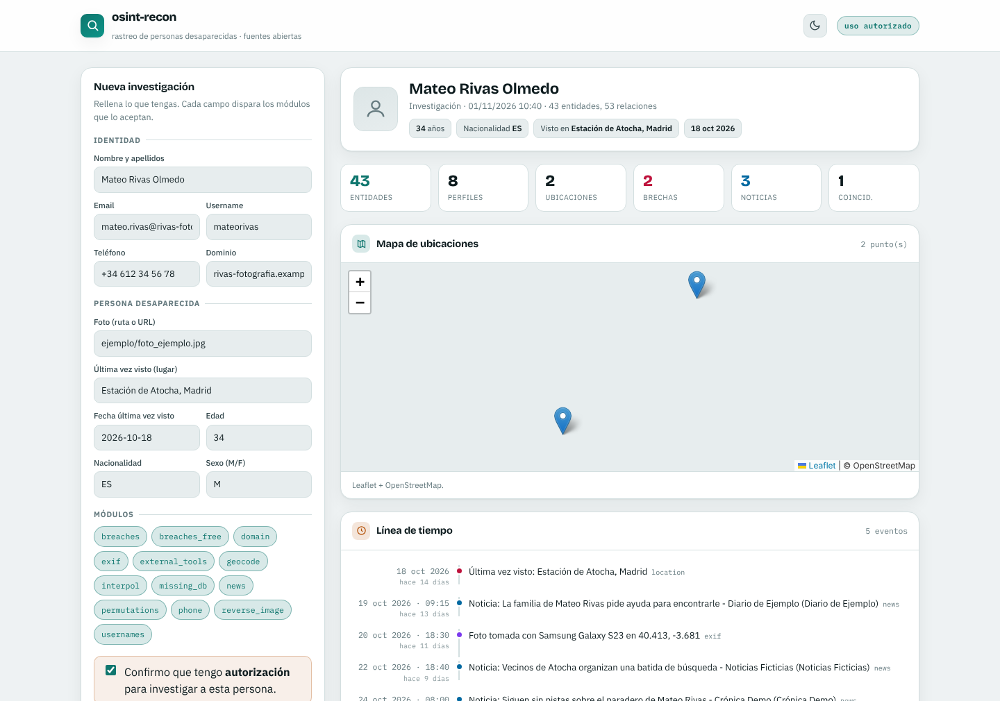
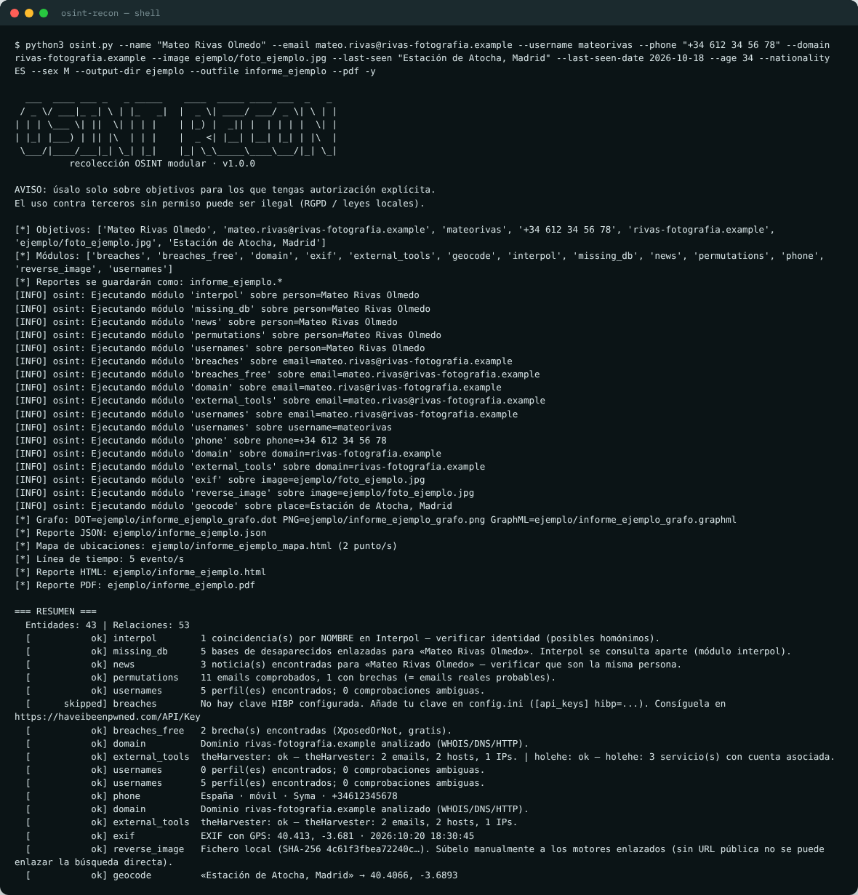
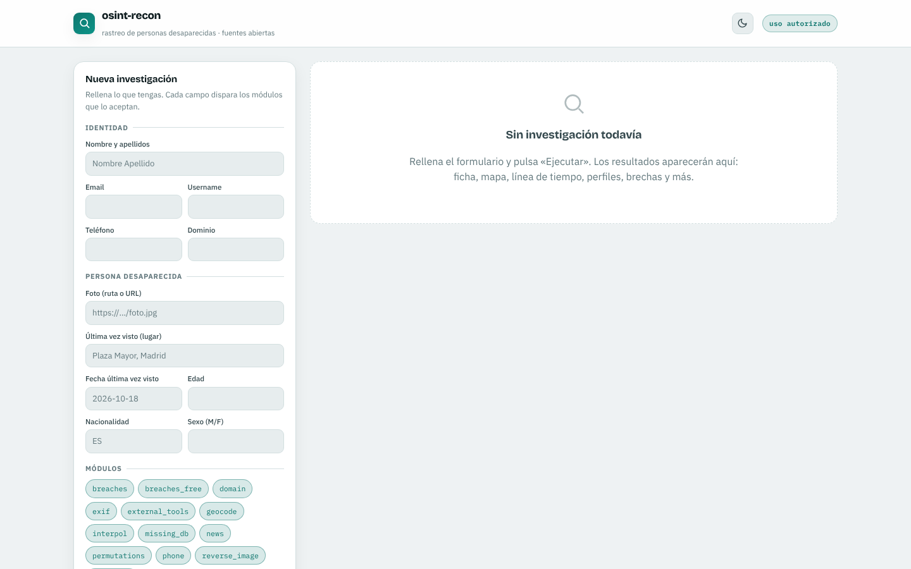
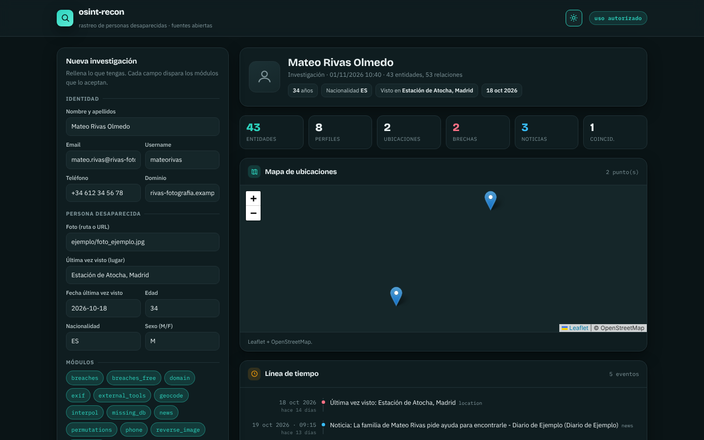
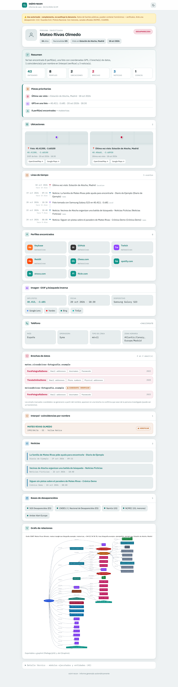
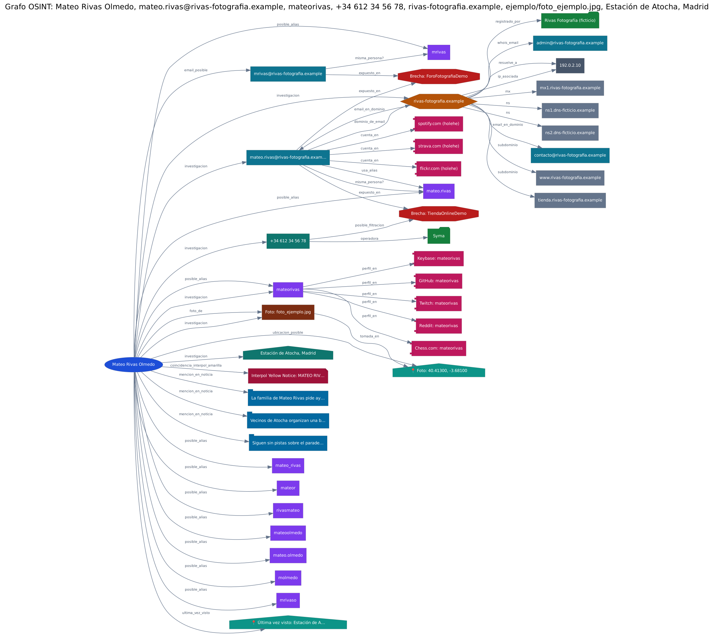

# osint-recon

Herramienta OSINT modular en Python. A partir de un **nombre, email, username,
teléfono o dominio** recolecta información de fuentes públicas, la correlaciona en
un grafo de relaciones y genera un informe en **HTML, PDF y JSON**. Se usa desde la
**terminal (shell)** o desde una **interfaz web**.

> ⚠️ **Uso autorizado únicamente.** Úsala solo sobre objetivos para los que tengas
> autorización explícita (auditorías, tu propia huella digital, consentimiento del
> titular). Investigar a terceros sin permiso puede ser ilegal (RGPD). La
> herramienta pide confirmar la autorización antes de cada ejecución.



## Cumplimiento del enunciado

| Requisito | Cómo se cumple | Dónde |
|---|---|---|
| Entrada de datos | Nombre, email, username, teléfono y dominio (además foto y última ubicación vista) | `osint.py`, `web/app.py` |
| Mínimo 3 fuentes | 13 módulos, entre ellos brechas (XposedOrNot y HIBP), usernames en 33 redes y WHOIS/DNS | `osintlib/modules/` |
| Herramienta externa | **theHarvester** y **holehe** por línea de comandos con parseo de su salida; **Graphviz** (`dot`) para el grafo; **Chromium** para el PDF | `external_tools.py`, `graphexport.py`, `pdfexport.py` |
| Reporte estructurado | HTML, PDF y JSON | `osintlib/report.py`, `osintlib/pdfexport.py` |
| Código modular y comentado | Cada fuente es un módulo independiente que se carga solo; todo el código está documentado | `osintlib/` |
| *Extra:* correlación | Datos repetidos se funden en un nodo; email ↔ username, persona ↔ objetivos, teléfono ↔ brechas | `osintlib/entity.py`, `osintlib/orchestrator.py` |
| *Extra:* grafo | PNG/SVG con Graphviz y **GraphML importable en Maltego** | `osintlib/graphexport.py` |
| *Extra:* interfaz web | Panel Flask con formulario, resultados, mapa, descargas y modo noche | `web/` |

Además del enunciado: 70+ tests automáticos, exportación a PDF, línea de tiempo y
mapa de ubicaciones, y funciones pensadas para la búsqueda de personas
desaparecidas (EXIF, Interpol, bases de desaparecidos).

---

## Instalación

### En CachyOS (o Arch Linux)

```bash
git clone https://github.com/Jorge-tech827/osint-recon/
cd osint-recon
bash setup.sh
```

`setup.sh` instala Python y Graphviz con `pacman`, crea un entorno virtual con las
dependencias y pregunta si quieres instalar también Chromium (para el PDF) y
theHarvester/holehe (herramientas externas). Con `bash setup.sh --full` lo instala
todo sin preguntar.

> En CachyOS el Python del sistema está protegido: no uses `sudo pip`. Todo va
> dentro del entorno virtual (`venv/`), que es lo que hace `setup.sh`.

### Con Python, en cualquier sistema

Necesitas **Python 3.9 o superior** (probado con 3.13), **Graphviz** para el grafo
y, opcionalmente, **Chromium o Chrome** para el PDF.

| Sistema | Graphviz | Chromium (opcional, PDF) |
|---|---|---|
| Debian, Ubuntu, Kali | `sudo apt install graphviz python3-venv` | `sudo apt install chromium` |
| macOS | `brew install graphviz` | Google Chrome |
| Windows | `winget install Graphviz.Graphviz` | Google Chrome o Microsoft Edge |

**Linux y macOS**

```bash
git clone https://github.com/Jorge-tech827/osint-recon/
cd osint-recon
python3 -m venv venv
source venv/bin/activate
pip install -r requirements.txt
```

**Windows (PowerShell)**

```powershell
git clone https://github.com/Jorge-tech827/osint-recon/
cd osint-recon
python -m venv venv
venv\Scripts\activate
pip install -r requirements.txt
```

**Herramientas externas (opcional, recomendado):**

```bash
pipx install theHarvester
pipx install holehe
```

Si no están instaladas, el informe lo indica ("NO INSTALADO") y el resto de la
herramienta funciona igual.

---

## Uso desde la terminal (shell)

Activa antes el entorno virtual (`source venv/bin/activate`, o
`venv\Scripts\activate` en Windows). En CachyOS puedes usar `./run.sh` en lugar de
`python osint.py`: activa el entorno él solo.

**Modo asistente.** Sin argumentos, pregunta los datos uno a uno (Enter para
saltar un campo), pide confirmar la autorización y el nombre del informe:

```bash
python osint.py          # en CachyOS: ./run.sh
```

**Con parámetros:**

```bash
# Búsqueda básica por nombre y email
python osint.py --name "Nombre Apellido" --email correo@dominio.com

# Persona desaparecida, con foto y última ubicación, y PDF
python osint.py --name "Nombre Apellido" --image ./foto.jpg \
    --last-seen "Plaza Mayor, Madrid" --last-seen-date 2026-10-18 \
    --age 34 --nationality ES --pdf

# Solo algunos módulos, sin preguntar y con nombre de informe fijo
python osint.py --domain dominio.com --modules domain,external_tools -y --outfile caso1
```

| Opción | Para qué sirve |
|---|---|
| `--name`, `--email`, `--username`, `--phone`, `--domain` | Datos a investigar (puedes combinar varios) |
| `--image` | Foto (ruta o URL): EXIF y búsqueda inversa |
| `--last-seen`, `--last-seen-date` | Última vez visto: lugar y fecha (mapa y línea de tiempo) |
| `--age`, `--nationality`, `--sex` | Filtros para reducir homónimos en Interpol |
| `--modules a,b` | Ejecutar solo esos módulos (por defecto, todos) |
| `--pdf` | Generar también el PDF |
| `--outfile NOMBRE` | Nombre de los ficheros del informe |
| `--output-dir DIR` | Carpeta de salida (por defecto `salidas/`) |
| `-y` | Confirmar la autorización sin preguntar |
| `-h` | Ayuda completa |

Los resultados se guardan en `salidas/`: informe `.html`, `.pdf` y `.json`, grafo
(`_grafo.png`, `.svg`, `.dot`, `.graphml`) y mapa (`_mapa.html`).

## Uso desde la web

```bash
python web/app.py        # en CachyOS, con el venv activado
```

Abre **http://127.0.0.1:5000**. Rellena los campos que tengas, elige los módulos,
marca la casilla de autorización y pulsa **Ejecutar investigación**. Los resultados
aparecen en tarjetas (ficha, mapa interactivo, línea de tiempo, perfiles, brechas…)
con botones para descargar el informe en HTML, PDF, JSON, el mapa y el GraphML. El
botón de la luna cambia entre modo claro y modo noche.

La web solo escucha en `127.0.0.1` (tu equipo): no la expongas a Internet.

---

## Ejemplo real de ejecución (datos ficticios)

La carpeta [`ejemplo/`](ejemplo/) contiene una ejecución real del CLI sobre una
persona inventada, **Mateo Rivas Olmedo**:

```bash
python osint.py --name "Mateo Rivas Olmedo" --email mateo.rivas@rivas-fotografia.example \
    --username mateorivas --phone "+34 612 34 56 78" --domain rivas-fotografia.example \
    --image ejemplo/foto_ejemplo.jpg --last-seen "Estación de Atocha, Madrid" \
    --last-seen-date 2026-10-18 --age 34 --nationality ES --sex M --pdf -y
```

| Fichero | Contenido |
|---|---|
| [`informe_ejemplo.html`](ejemplo/informe_ejemplo.html) | Informe completo (ábrelo en el navegador) |
| [`informe_ejemplo.pdf`](ejemplo/informe_ejemplo.pdf) | El mismo informe en PDF |
| [`informe_ejemplo.json`](ejemplo/informe_ejemplo.json) | Datos estructurados: entidades, relaciones y resultados por módulo |
| [`informe_ejemplo_grafo.png`](ejemplo/informe_ejemplo_grafo.png) | Grafo de relaciones (también `.svg`, `.dot` y `.graphml` para Maltego) |
| [`informe_ejemplo_mapa.html`](ejemplo/informe_ejemplo_mapa.html) | Mapa de ubicaciones |
| [`salida_cli.txt`](ejemplo/salida_cli.txt) | Salida completa de la terminal |

Resultado de la ejecución (resumido):

```
=== RESUMEN ===
  Entidades: 43 | Relaciones: 53
  [ok] interpol        1 coincidencia(s) por NOMBRE en Interpol — verificar identidad
  [ok] news            3 noticia(s) encontradas para «Mateo Rivas Olmedo»
  [ok] permutations    11 emails comprobados, 1 con brechas
  [ok] usernames       5 perfil(es) encontrados
  [ok] breaches_free   2 brecha(s) encontradas (XposedOrNot, gratis)
  [ok] domain          Dominio rivas-fotografia.example analizado (WHOIS/DNS/HTTP)
  [ok] external_tools  theHarvester: 2 emails, 2 hosts, 1 IPs | holehe: 3 servicio(s)
  [ok] phone           España · móvil · Syma · +34612345678
  [ok] exif            EXIF con GPS: 40.413, -3.681 · 2026:10:20 18:30:45
  [ok] geocode         «Estación de Atocha, Madrid» → 40.4066, -3.6893
```

**Cómo se generó.** El ejemplo lo crea [`demo.py`](demo.py), que lanza el CLI real
con todos los módulos. Para que los resultados sean ficticios y reproducibles sin
conexión, solo se simula lo que saldría a Internet: las respuestas de las APIs
(redes sociales, XposedOrNot, Interpol, Google News, Nominatim), DNS y WHOIS, y la
salida de theHarvester y holehe (con su formato real, ejecutados como procesos
externos). La clasificación, los módulos, la correlación, el grafo con Graphviz,
el informe y el PDF con Chromium son los reales. Los datos usan el dominio
reservado `.example`, IPs de documentación (`192.0.2.x`) y el número de ejemplo
de la librería `phonenumbers`. Para regenerarlo (Linux o macOS):

```bash
pip install -r requirements-dev.txt   # incluye Pillow, que usa demo.py
python demo.py
```

## Capturas

**Terminal (shell)**



**Web: formulario**



**Web: resultados de una investigación**


**Web: modo noche**



**Informe HTML generado**



**Grafo de relaciones**



> Las capturas se hicieron sin conexión a Internet, por eso el mapa de la web
> aparece sin calles (solo los marcadores). Con conexión carga el mapa completo de
> OpenStreetMap.

---

## Módulos

| Módulo | Qué hace | Entrada |
|---|---|---|
| `usernames` | Busca el alias en 33 redes y servicios | nombre, email, username |
| `breaches_free` | Brechas de datos en XposedOrNot (gratis) | email |
| `breaches` | Brechas en Have I Been Pwned (requiere clave de pago) | email |
| `permutations` | Genera emails probables a partir del nombre y los busca en brechas | nombre |
| `domain` | WHOIS, DNS y cabeceras HTTP | dominio, email |
| `external_tools` | Ejecuta theHarvester y holehe y parsea su salida | dominio, email |
| `phone` | País, operadora, tipo de línea y zona horaria | teléfono |
| `interpol` | Coincidencias en notificaciones públicas de Interpol | nombre |
| `news` | Noticias que mencionan el nombre (Google News) | nombre |
| `exif` | GPS, fecha y dispositivo de una foto | foto |
| `reverse_image` | Enlaces de búsqueda inversa de la foto | foto |
| `missing_db` | Enlaces a bases de personas desaparecidas | nombre |
| `geocode` | Coordenadas de la última ubicación vista | lugar |

Detalle de cada módulo, ajustes y cómo añadir uno nuevo: [docs/MODULOS.md](docs/MODULOS.md).

## Configuración

```bash
cp config.example.ini config.ini
```

Todo es opcional. Lo principal: la clave de Have I Been Pwned (`[api_keys] hibp`,
de pago; sin ella se usa XposedOrNot, que es gratis), la región para teléfonos sin
prefijo (`phone_region = ES`) y la permutación de emails (`permute_*`).

## Tests

```bash
pip install -r requirements-dev.txt
pytest
```

Más de 70 tests de la lógica que no depende de la red (clasificación de entradas,
grafo, correlación, línea de tiempo, EXIF, parseo de cada módulo y de las
herramientas externas, informe). No usan Internet y tardan unos segundos.

## Estructura

```
osint-recon/
├── osint.py            CLI (shell)
├── demo.py             Genera el ejemplo de ejecución
├── setup.sh, run.sh    Instalación y atajo para CachyOS/Arch
├── osintlib/           Núcleo: grafo, orquestador, informe, PDF, mapa, línea de tiempo
│   └── modules/        Un fichero por fuente de datos (se cargan solos)
├── web/                Interfaz web (Flask)
├── tests/              Tests (pytest)
├── ejemplo/            Ejecución real con datos ficticios
└── docs/               Capturas y documentación de módulos
```

## Responsabilidad

Proyecto educativo y de auditoría autorizada. Los datos proceden de fuentes
públicas y pueden contener homónimos: los resultados marcados como coincidencia o
candidato deben verificarse. Quien la use es responsable de hacerlo conforme a la
ley y con autorización. En la búsqueda de personas desaparecidas complementa, no
sustituye, la denuncia ante las autoridades.
